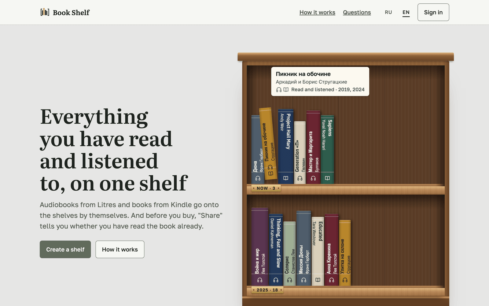
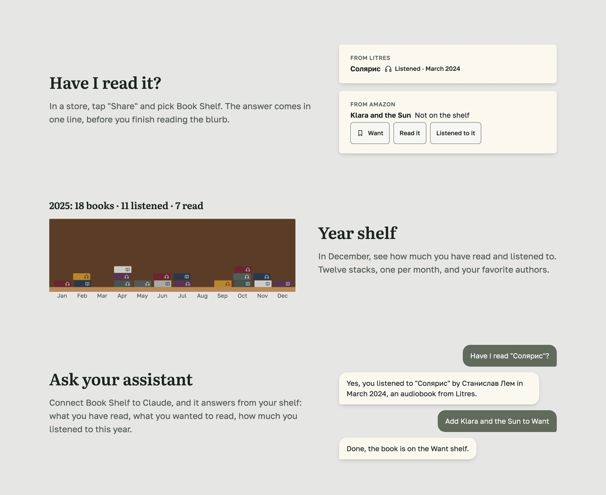

<p align="center">
  <a href="https://bshelf.org"></a>
</p>

<h1 align="center">Book Shelf</h1>

<p align="center">
  Everything you have read and listened to, on one shelf.<br>
  Audiobooks from Litres and books from Kindle land on the shelves by themselves.
</p>

<p align="center">
  <a href="https://bshelf.org"><b>bshelf.org</b></a>
  ·
  <a href="API.md">API</a>
  ·
  <a href="design/README.md">Design system</a>
</p>

<p align="center">
  <a href="https://github.com/AlexKlim/bshelf/actions/workflows/ci.yml"></a>
</p>

<p align="center">
  <a href="https://bshelf.org"></a>
</p>

## What it does

- **One shelf for every store.** Litres audiobooks and Kindle books sync in, a paper book or a gift is added by hand. A book bought in two stores becomes one.
- **Have I read it?** In a store app, tap "Share" and pick Book Shelf. The answer comes in one line, before you finish reading the blurb.
- **Year shelf.** Twelve stacks, one per month, with how much you read and listened to and your favorite authors.
- **Ask your assistant.** Connect Book Shelf to Claude, ChatGPT or Gemini over MCP, and it answers from your shelf.
- **Your password stays yours.** Kindle sign-in happens in a live browser on the server that you drive yourself. The password is never stored and the session is deleted after the sync.

<p align="center">
  
</p>

## Stack

| | |
|---|---|
| API | Rails 8.1, Postgres, Devise, Doorkeeper (OAuth for MCP clients) |
| Jobs | Solid Queue inside Puma |
| Client | React + Vite PWA, served by Rails from `public/` on one origin |
| Store sync | Self-hosted Steel browser driven over CDP with Ferrum |
| Mail | Resend HTTP API |
| Hosting | Railway, DNS on Cloudflare |

## Development

Requirements: Ruby 3.4.8 (`.ruby-version`), Postgres 14+, Node 22.

```sh
bin/setup                  # gems, client packages, database
bin/dev                    # Rails API + jobs on :3000
cd client && npm run dev   # Vite on :5173, proxies /api to :3000
```

Open http://localhost:5173. Emails (confirmation, password reset) open in the browser via letter_opener.

## Tests

```sh
bundle exec rspec
cd client && npm test -- --run && npm run lint
```

## Production

The `Dockerfile` builds the client into `public/` and serves it from Rails. Railway deploys `main` on every merge. Service settings live in [`.railway/railway.ts`](.railway/railway.ts) and are applied by the `Railway config` workflow.

Environment: `DATABASE_URL`, `SECRET_KEY_BASE`, `APP_URL` (public URL, used in email links), `MAIL_FROM`, `RESEND_API_KEY` (Railway blocks outbound SMTP, so mail goes through the Resend HTTP API), `STEEL_URL` (private address of the Steel browser). Set `SOLID_QUEUE_IN_PUMA=false` only if jobs move to a separate worker.

## Contributing

`main` is protected. Open a pull request: CI and a CodeRabbit review run on it.
